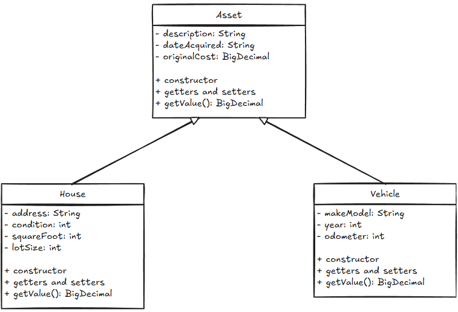

# Abstract Assets Manager

This is my assets project, version two. It keeps a list of everything I own (houses, vehicles, cash and jewelry), prints what I paid for each one and what it's worth now, and adds it all up into my net worth.

## What changed from assets-manager

I made Asset abstract and turned getValue() into an abstract method with no body. Then I tried new Asset(...) in main just to see what happens. It won't compile: "Asset is abstract; cannot be instantiated." That makes sense to me now. Asset is just the idea of "something I own," and you can't own just an idea. You own a house or a car or some cash.

## The Cash question (What went wrong)

I started with public class Cash extends Asset and nothing inside it, and IntelliJ lit up red. There were two problems:

1. getValue() was missing. Since getValue() is abstract in Asset, every child that isn't abstract has to write its own version.
2. There was no constructor. Asset needs a description, a date acquired and an original cost, so Cash needs a constructor that passes them up with super(...). I ran into the same thing in the vehicle exercise.

## I went with option 
1. Write getValue() in Cash. Cash never changes value, so it just returns the original cost.
2. Make Cash abstract too. The red error goes away, but I could never create a Cash object, so my mattress money would be useless.
3. Take abstract back out of Asset. It would work, but then I could create a plain Asset, and a new kind of asset could forget getValue() and nobody would be told.

## What I picked and why

I went with option 1. Cash is a real thing I own, so it can't be abstract. And I like that the abstract method forces every kind of asset to say how it's valued, so none of them can forget. For cash it's only one line, return getOriginalCost();, and the loop in main treats it like every other asset.

## Running it

Run Main. For each asset it prints the description, the type, the date I got it, what I paid and what it's worth. At the end it prints my net worth. The tests are in src/test/java/com/pluralsight.

# Abstract Assets Manager

This is my assets project, version two. It keeps a list of everything I own (houses, vehicles, cash and jewelry), prints what I paid for each one and what it's worth now, and adds it all up into my net worth.

## What changed from assets-manager

I made Asset abstract and turned getValue() into an abstract method with no body. Then I tried new Asset(...) in main just to see what happens. It won't compile: "Asset is abstract; cannot be instantiated." That makes sense to me now. Asset is just the idea of "something I own," and you can't own just an idea. You own a house or a car or some cash.

## The Cash question (What went wrong)

I started with public class Cash extends Asset and nothing inside it, and IntelliJ lit up red. There were two problems:

1. getValue() was missing. Since getValue() is abstract in Asset, every child that isn't abstract has to write its own version.
2. There was no constructor. Asset needs a description, a date acquired and an original cost, so Cash needs a constructor that passes them up with super(...). I ran into the same thing in the vehicle exercise.

## I went with option
1. Write getValue() in Cash. Cash never changes value, so it just returns the original cost.
2. Make Cash abstract too. The red error goes away, but I could never create a Cash object, so my mattress money would be useless.
3. Take abstract back out of Asset. It would work, but then I could create a plain Asset, and a new kind of asset could forget getValue() and nobody would be told.

## What I picked and why

I went with option 1. Cash is a real thing I own, so it can't be abstract. And I like that the abstract method forces every kind of asset to say how it's valued, so none of them can forget. For cash it's only one line, return getOriginalCost();, and the loop in main treats it like every other asset.

## Running it

Run Main. For each asset it prints the description, the type, the date I got it, what I paid and what it's worth. At the end it prints my net worth. The tests are in src/test/java/com/pluralsight.

## Excalidraw
# Abstract Assets Manager

This is my assets project, version two. It keeps a list of everything I own (houses, vehicles, cash and jewelry), prints what I paid for each one and what it's worth now, and adds it all up into my net worth.

## What changed from assets-manager

I made Asset abstract and turned getValue() into an abstract method with no body. Then I tried new Asset(...) in main just to see what happens. It won't compile: "Asset is abstract; cannot be instantiated." That makes sense to me now. Asset is just the idea of "something I own," and you can't own just an idea. You own a house or a car or some cash.

## The Cash question (What went wrong)

I started with public class Cash extends Asset and nothing inside it, and IntelliJ lit up red. There were two problems:

1. getValue() was missing. Since getValue() is abstract in Asset, every child that isn't abstract has to write its own version.
2. There was no constructor. Asset needs a description, a date acquired and an original cost, so Cash needs a constructor that passes them up with super(...). I ran into the same thing in the vehicle exercise.

## I went with option
1. Write getValue() in Cash. Cash never changes value, so it just returns the original cost.
2. Make Cash abstract too. The red error goes away, but I could never create a Cash object, so my mattress money would be useless.
3. Take abstract back out of Asset. It would work, but then I could create a plain Asset, and a new kind of asset could forget getValue() and nobody would be told.

## What I picked and why

I went with option 1. Cash is a real thing I own, so it can't be abstract. And I like that the abstract method forces every kind of asset to say how it's valued, so none of them can forget. For cash it's only one line, return getOriginalCost();, and the loop in main treats it like every other asset.

## Running it

Run Main. For each asset it prints the description, the type, the date I got it, what I paid and what it's worth. At the end it prints my net worth. The tests are in src/test/java/com/pluralsight.

## Excalidraw
